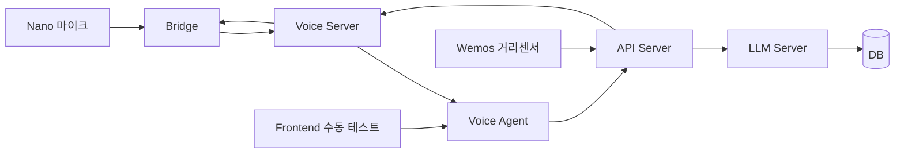

# Super_Marimo


Super_Marimo는 **디바이스 이벤트 중심의 로컬 음성 대화 스택**입니다.  
RP2040(Nano) 마이크, Wemos 거리센서, Windows 브릿지, Docker 기반 백엔드를 묶어서
`호출어 대화`, `선제 인사`, `수동 테스트`를 하나의 흐름으로 연결합니다.

## 프로젝트 한눈에 보기

- **문제**: 센서와 음성 입력이 따로 놀면, 실제 사용 흐름을 끝까지 검증하기 어렵습니다.
- **해결**: 입력 이벤트를 기준으로 백엔드, LLM, TTS, DB, 프론트가 이어지는 구조를 만들었습니다.
- **결과**: 포트폴리오에서 바로 보여줄 수 있는 로컬 음성 대화 시스템과 테스트 UI를 확보했습니다.

## 핵심 포인트

- **이벤트 중심 아키텍처**: 호출어, 거리센서, 프론트 수동 입력이 모두 같은 대화 파이프라인을 탑니다.
- **로컬 우선 구조**: Docker 서비스와 Windows 브릿지를 분리해 실제 장치 연동을 안정적으로 다룹니다.
- **상태가 보이는 UI**: 프론트는 단순 채팅창이 아니라 센서 상태, 대화 흐름, 테스트 동작을 확인하는 콘솔 역할을 합니다.
- **운영 문서화**: 실행 가이드, 네트워크 주소 매트릭스, 보고서 문서를 함께 관리합니다.

## 동작 흐름



### 1. 호출어 기반 대화

1. Nano 마이크가 호출어를 받습니다.
2. Bridge가 VAD와 시리얼 흐름을 처리합니다.
3. Voice Server가 STT를 수행합니다.
4. Voice Agent가 `/ask` 또는 `/voice/ask` 흐름을 이어받습니다.
5. API Server가 LLM과 DB 저장을 담당합니다.
6. Voice Server가 TTS를 만들고 Bridge가 스피커로 재생합니다.

### 2. 거리센서 기반 선제 인사

1. Wemos가 거리 이벤트를 보냅니다.
2. API Server가 거리값과 쿨다운을 판단합니다.
3. 조건이 맞으면 `proactive_greeting` 이벤트가 생성됩니다.
4. Voice Agent가 이벤트를 폴링해서 TTS 재생으로 연결합니다.

### 3. 프론트 수동 테스트

1. 프론트에서 직접 `/ask`를 호출합니다.
2. 응답은 LLM과 DB를 거쳐 다시 UI로 돌아옵니다.
3. 필요하면 TTS까지 이어서 확인합니다.

## 서비스 구성

| 서비스 | 역할 | 포트 |
|--------|------|------|
| `db-server` | PostgreSQL | `5432` |
| `api-server` | 세션, 메시지, 센서 이벤트 저장 | `8000` |
| `llm-server` | 응답 생성 | `8001` |
| `voice-server` | STT / TTS | `8002` |
| `voice-agent` | 대화 오케스트레이션, 이벤트 폴링 | `8003` |
| `bridge` | Windows host 전용 시리얼 + 스피커 브릿지 | - |

## 빠른 실행

### 1) 전체 서비스 실행

```powershell
cd C:\Projects\_active\Super_Marimo
docker compose -f docker-compose.yml -f docker-compose.gpu.yml up -d --build db-server api-server llm-server voice-server voice-agent
```

### 2) Bridge 실행

```powershell
cd C:\Projects\_active\Super_Marimo
pip install -r requirements-bridge.txt
python -m bridge.main --port COM4
```

### 3) 프론트 실행

```powershell
cd C:\Projects\_active\Super_Marimo\frontend
npm install
npm run dev
```

프론트는 `http://localhost:5173`에서 열립니다.

## 검증 포인트

| 서비스 | Health | Ready |
|--------|--------|-------|
| API Server | `http://localhost:8000/health` | - |
| LLM Server | `http://localhost:8001/health` | `http://localhost:8001/ready` |
| Voice Server | `http://localhost:8002/health` | `http://localhost:8002/ready` |
| Voice Agent | `http://localhost:8003/health` | - |

## Compose 모드

| 파일 | 용도 |
|------|------|
| `docker-compose.yml` | 공통 베이스 |
| `docker-compose.mock.yml` | 모델 없이 전체 흐름 테스트 |
| `docker-compose.cpu.yml` | CPU-only 테스트 |
| `docker-compose.gpu.yml` | GPU 실행 |
| `docker-compose.dev.yml` | 소스코드 live reload |

## 포트폴리오 관점의 강점

- **하드웨어 입력부터 답변 출력까지 end-to-end를 직접 연결**했습니다.
- **센서 이벤트와 음성 대화를 같은 시스템 안에서 운영**하도록 설계했습니다.
- **브릿지/백엔드/프론트 역할을 분리**해 실제 장치 연동과 UI 검증을 동시에 할 수 있습니다.
- **실행 가능한 문서와 보고서가 함께 남는 구조**라서 재현성과 설명력이 좋습니다.

## 관련 문서

- [프로젝트 규칙](docs/01_프로젝트_규칙.md)
- [GitHub 운영 규칙](docs/03_GitHub_운영_규칙.md)
- [네트워크 주소 매트릭스](docs/network_address_matrix.md)
- [문제 해결 가이드](docs/troubleshooting.md)
- [음성 루프 보고서](report/25_voice_loop_backend_frontend_report.md)

## 메모

- Bridge는 Windows 전용입니다. COM 포트와 `winsound`를 직접 사용합니다.
- Voice Agent 컨테이너는 `./shared/audio/`를 Bridge와 공유합니다.
- 선제 인사 쿨다운 기본값은 60초입니다.
- `.env.mock`, `.env.cpu`, `.env.gpu`, `.env.local`로 실행 모드와 로컬 주소를 분리합니다.
- 런타임 산출물인 `bridge/session.json`과 `shared/audio/cache/*.wav`는 `.gitignore`로 제외합니다.
