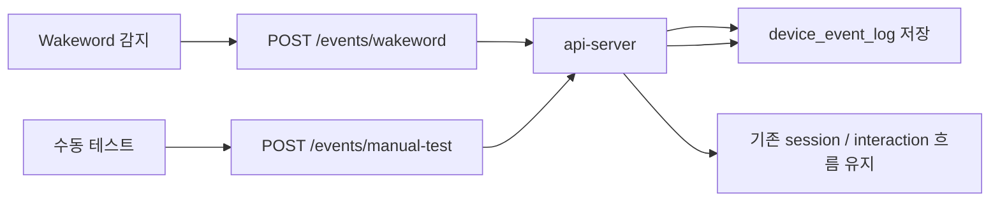

# wakeword/manual-test 베타 이벤트 구현 보고서

## 요약
- `wakeword`와 `manual-test`를 베타 공용 이벤트로 먼저 구현했다.
- `sensor-warning`는 임계치가 사용자 결정사항이므로 보류했다.
- 구조 변경 보고서 규칙에 맞춰, 최상단에 수정된 다이어그램을 두는 기준도 함께 고정했다.

## 변경 내용
- `api-server`에 `device_event_log`를 추가했다.
- `POST /events/wakeword`와 `POST /events/manual-test`를 추가했다.
- 이벤트 저장 전용 서비스(`device_event_service`)를 분리했다.
- 이벤트 payload 스키마를 정리해서 공용 이벤트 입력을 단순화했다.
- `device_event_log`는 `wakeword`와 `manual_test`만 받도록 제한했다.
- 보고서 규칙과 report 스킬에 "구조 변경 시 다이어그램 최상단" 규칙을 넣었다.

## 검증 결과
- `docker compose up -d --build db-server api-server` 성공
- `docker compose exec api-server python -m pytest tests/test_health.py tests/test_events.py` 성공
- `POST /events/wakeword` 저장 확인
- `POST /events/manual-test` 저장 확인
- DB에서 `device_event_log`에 두 이벤트가 모두 쌓인 것 확인

## 남은 이슈
- `sensor-warning` 임계치와 쿨다운 정책은 사용자 결정이 필요하다.
- 거리센서 자동 반응은 다음 단계에서 설계해야 한다.
- 구조 변경이 더 생기면 보고서 최상단 다이어그램을 계속 갱신해야 한다.

## 다음 단계
- 사용자와 `sensor-warning` 임계치 기준을 확정한다.
- 확정 후 거리 기반 자동 인사/경고 흐름을 추가한다.
- 다음 구조 변경 시에는 새 report를 또 작성한다.
