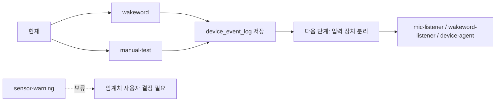

# Goal 기준 다음 작업 정리

## 요약
- 현재 베타 공용 이벤트는 `wakeword`와 `manual-test`까지만 먼저 유지한다.
- `sensor-warning`는 임계치가 사용자 결정사항이라 이번 단계에서는 보류한다.
- 다음 큰 일은 입력 장치 분리와 음성 흐름 정리다.

## 현재 상태
- `api-server`는 `device_event_log`에 `wakeword`와 `manual_test`를 저장한다.
- `voice-agent`는 기존 `/voice/ask` 흐름을 유지한다.
- `report/` 폴더에 작업 결과를 쌓는 규칙을 적용했다.
- 브랜치는 `backend/jiyang`을 사용한다.

## 다음 작업
- `sensor-warning` 임계치와 쿨다운 기준을 사용자와 확정한다.
- 확정 후 거리/센서 기반 자동 반응을 추가한다.
- 입력 장치 분리 구조를 잡는다.
  - `mic-listener`
  - `wakeword-listener`
  - `device-agent`
- 구조 변경이 생기면 다시 `report/`에 새 보고서를 남긴다.

## 검증 기준
- `wakeword` 이벤트 저장이 유지되는지 확인
- `manual-test` 이벤트 저장이 유지되는지 확인
- `device_event_log`에 두 이벤트가 분리 저장되는지 확인
- 다음 구조 변경 시 보고서 최상단에 다이어그램이 들어가는지 확인

## 참고
- 이번 문서는 구조 변경 보고서가 아니라 Goal 기반 다음 단계 정리다.
- 다이어그램 규칙은 `docs/09_작업_종료_보고서_규칙.md`를 따른다.
