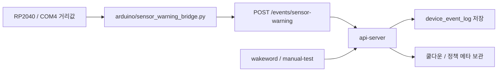

# sensor-warning COM4 브리지 구현 보고서

## 요약
- `sensor-warning`를 베타 이벤트로 열었다.
- COM4에서 읽은 거리값을 기준으로 `device_event_log`에 저장한다.
- 임계치와 쿨다운은 코드에 고정하지 않고, 실행 시 사용자가 넘기는 값으로 둔다.

## 변경 내용
- `api-server`에 `POST /events/sensor-warning`를 추가했다.
- `device_event_log`의 `event_type` 제약에 `sensor_warning`을 추가했다.
- `api_server/schemas.py`에 `SensorWarningEventPayload`를 추가했다.
- `api_server/services/device_event_service.py`가 `sensor_warning`을 저장하도록 확장했다.
- `arduino/sensor_warning_bridge.py`를 추가해 COM4 거리값을 읽고 경고 이벤트를 보내게 했다.
- `docs/08_베타_전환_운영_규칙.md`, `api_server/README.md`, `README.md`를 현재 흐름에 맞게 정리했다.

## 검증 결과
- `python -m py_compile`로 변경된 파이썬 파일 문법 확인 완료
- `docker compose up -d --build db-server api-server` 성공
- `docker compose exec api-server python -m pytest tests/test_health.py tests/test_events.py` 성공
- `POST /events/sensor-warning` 실제 호출 성공
- DB에서 `device_event_log`에 `sensor_warning`이 저장된 것 확인

## 남은 이슈
- RP2040 펌웨어가 거리값을 어떤 라인 형식으로 내보낼지는 장치 쪽에서 맞춰야 한다.
- 임계치와 쿨다운은 아직 사용자 결정값이라, 실행할 때 같이 정해야 한다.
- 현재 브리지는 COM4 텍스트 거리값 입력을 전제로 한다.

## 다음 단계
- RP2040 쪽 거리 출력 포맷을 확정한다.
- 사용자와 임계치 / 쿨다운 값을 최종 확정한다.
- 자동 인사나 추가 센서 연동이 필요하면 그때 별도 브랜치로 분리한다.
