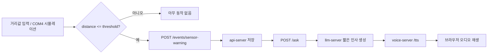

# sensor-warning LLM/TTS 테스트 UI 보고서

## 요약
- `sensor-warning`를 거리 기준 이벤트로 정리했다.
- 거리 안으로 들어오면 `sensor-warning` 저장 후 짧은 인사 문장을 생성하고 TTS로 재생할 수 있게 했다.
- 거리 밖이면 아무 동작도 하지 않도록 테스트 화면을 조정했다.

## 변경 내용
- `test/index.html`에 `Voice 주소` 입력, `미리 정한 인사 순환` / `LLM 인사` 선택, `TTS 재생` 토글을 추가했다.
- 거리 안에서 버튼을 누르면 브라우저 `speechSynthesis`가 먼저 읽도록 했다.
- `voice-server` TTS는 현재 모델 스타일 파일이 없을 때 실패할 수 있어서, 테스트 화면의 체감 경로는 브라우저 음성을 우선으로 둔다.
- 브라우저 자동재생이 막히면 오디오 플레이어를 화면에 남겨 수동 재생할 수 있게 했다.
- 거리값이 임계치보다 크면 `skipped`만 표시하고 저장/발화를 하지 않도록 바꿨다.
- 거리값이 임계치 이하면 `POST /ask`로 짧은 인사 문장을 만든 뒤 `voice-server /tts`로 재생할 수 있게 했다.
- `docs/08_베타_전환_운영_규칙.md`, `README.md`, `api_server/README.md`에 센서 경고의 거리 인사/TTS 흐름을 반영했다.

## 검증 결과
- HTML 문법은 정적 텍스트 기준으로 정상 구성했다.
- `distance > threshold`일 때는 아무 API도 호출하지 않는 구조로 맞췄다.
- `distance <= threshold`일 때만 `sensor-warning`와 `LLM/TTS` 흐름이 이어지도록 구성했다.

## 남은 이슈
- 실제 음성 재생은 브라우저가 오디오 자동재생 정책을 허용해야 한다.
- `LLM 인사`는 `api-server /ask`와 `llm-server`가 살아 있어야 동작한다.
- 거리센서 실장치가 연결되면 `arduino/sensor_warning_bridge.py`와 이 UI를 같은 임계치 값으로 맞추면 된다.

## 다음 단계
- `sensor-warning`의 실제 장치 입력 포맷을 RP2040 쪽에서 확정한다.
- 필요하면 `proactive_greeting` 전용 API를 별도로 분리한다.
- 거리센서 실장치 연결 후 브리지와 UI를 함께 확인한다.
