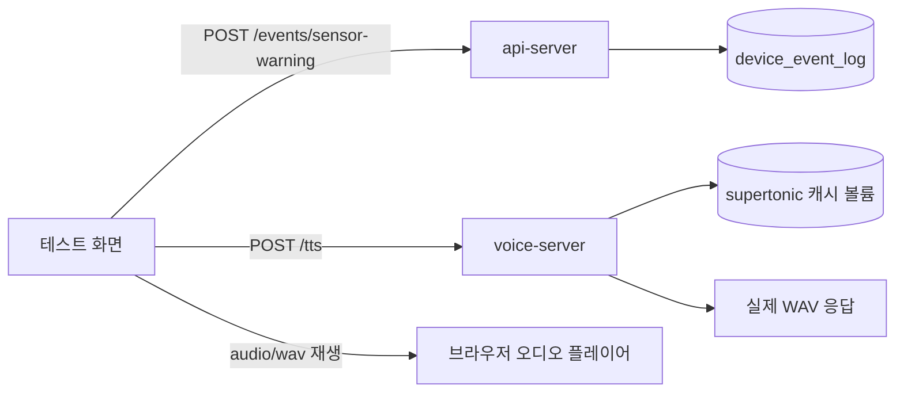

# 수정 다이어그램

# voice-server 실제 TTS 고정 및 테스트 화면 정리

## 변경 내용
- `voice-server`의 Supertonic 캐시를 Docker 볼륨으로 고정했다.
- `voice-server`가 TTS 준비 완료 상태일 때만 healthy로 보이도록 healthcheck를 추가했다.
- `voice-agent`가 `voice-server` healthy 이후에만 뜨도록 의존성을 바꿨다.
- 테스트 화면에서 브라우저 음성 fallback을 제거하고, `voice-server /tts`만 사용하도록 정리했다.
- `sensor-warning`는 `distance <= threshold`일 때만 저장하고, 그 뒤 서버 TTS를 재생한다.

## 확인한 흐름
- `wakeword`는 DB 저장만 수행한다.
- `manual-test`는 DB 저장만 수행한다.
- `sensor-warning`는 거리 조건을 만족할 때 저장 후 서버 TTS를 호출한다.
- `distance > threshold`면 아무 일도 하지 않는다.

## 검증 계획
- `voice-server` 재기동 후 `/health`에서 `tts_ready=true` 확인
- `POST /tts`가 실제 WAV를 반환하는지 확인
- `test/index.html`에서 `distance=50`, `threshold=50`일 때 소리가 재생되는지 확인
- `distance=52`, `threshold=50`일 때 아무 동작도 없는지 확인

