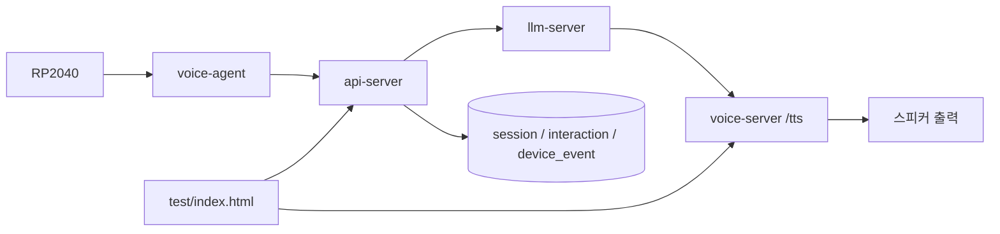

# 수정 다이어그램

# RP2040 단일 환경 기준 현재 목표 정리

## 변경 내용
- RP2040이 거리값을 보내지 않는 전제를 기준으로 목표를 다시 정리했다.
- 현재 테스트 페이지를 `wakeword`, `manual-test`, `voice/ask`, `voice-server /tts`만 확인하는 최소 페이지로 줄였다.
- `sensor-warning`와 `proactive_greeting`은 다음 하드웨어가 붙을 때 다시 다루는 보류 항목으로 정리했다.
- `README.md`, `api_server/README.md`, `voice_agent/README.md`를 현재 범위에 맞게 다시 썼다.

## 현재 할 일
- `wakeword` 저장 확인
- `manual-test` 저장 확인
- `voice/ask` 저장 확인
- `voice-server /tts` 실제 재생 확인
- `git status`, `git diff`, 커밋, 푸시, PR, report를 작업 사이클에 포함

## 보류 항목
- 거리센서 기반 `sensor-warning`
- `proactive_greeting`
- 거리 쿨다운
- RP2040 거리 브리지

## 확인 기준
- 테스트 페이지에서 버튼 하나로 저장/응답을 확인할 수 있어야 한다.
- 브라우저 음성 fallback 없이 서버 TTS만 사용해야 한다.
- 구조 변경이 생기면 다음 보고서의 최상단에 다이어그램을 둔다.

