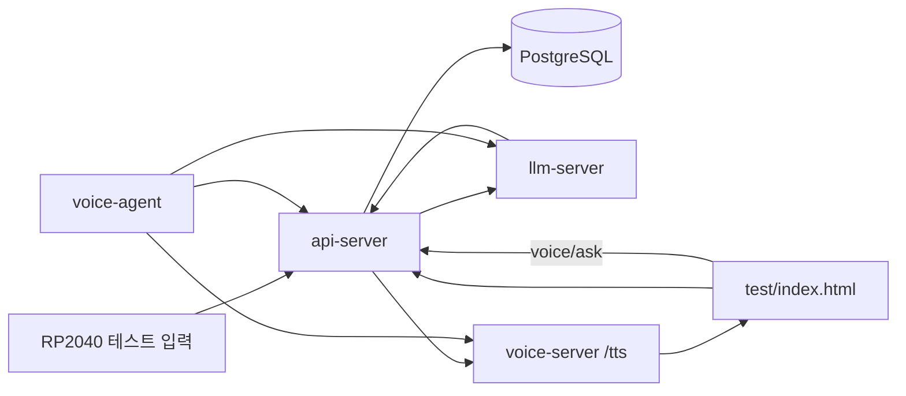

# RP2040 최소 베타 실행 보고서

## 변경 내용
- RP2040 단일 환경에서 확인할 수 있는 최소 경로를 유지했다.
- 테스트 페이지를 다시 작성해서 `health`, `wakeword`, `manual-test`, `voice/ask`, `voice/ask + TTS`, `TTS만 재생`만 남겼다.
- API 타입 정의와 운영 문서를 정리해서 현재 구조를 읽기 쉽게 만들었다.
- Goal의 센서 구조는 설계상 유지하되, 현재 장비 기준에서는 보류로 남겼다.

## Goal 정합성
- 맞는 부분
  - `voice-agent` 오케스트레이션
  - `voice-server` STT/TTS
  - `api-server` 저장/세션/이벤트
  - 프론트의 상태판/테스트 패널 역할
- 보류한 부분
  - 거리센서 기반 `sensor-warning`
  - `proactive_greeting`
  - 거리 쿨다운
  - 입력 장치 분리 서비스

## 검증 결과
- `python -m py_compile api_server/schemas.py api_server/routers/events.py api_server/services/device_event_service.py api_server/app.py voice_agent/main.py voice_server/main.py` 통과
- `docker compose up -d --build db-server api-server llm-server voice-server voice-agent` 성공
- `docker compose exec api-server python -m pytest tests/test_health.py tests/test_events.py` 통과
- `GET /health` 확인
- `POST /events/wakeword` 저장 확인
- `POST /events/manual-test` 저장 확인
- `POST /tts` 실제 WAV 반환 확인

## 다음 단계
- 실제 센서가 붙으면 `sensor-warning`와 `proactive_greeting`을 다시 연결한다.
- 현재 브랜치 `backend/jiyang`에서 커밋과 PR을 정리한다.
