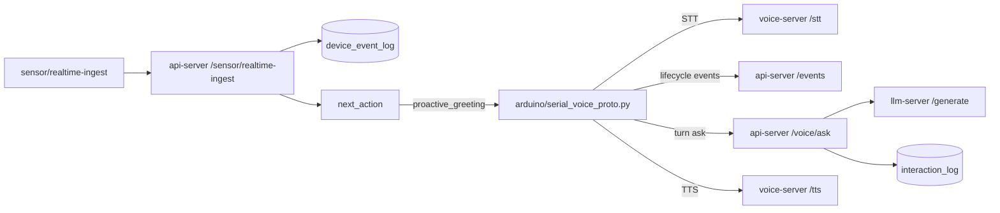

# 백엔드 정합성 복원 보고서

## 요약
- `voice-agent`는 HTTP 게이트웨이 역할을 유지하고, 실제 음성 루프는 `arduino/serial_voice_proto.py`가 맡도록 맞췄다.
- `POST /events` 공통 엔드포인트를 추가하고, 기존 `POST /events/wakeword`, `POST /events/manual-test`는 호환 래퍼로 유지했다.
- `device_event_log` 허용 이벤트를 Goal 기준으로 확장했다.
- `sensor/realtime-ingest`에 거리 기반 정책을 복원하고, 응답에 `next_action`을 포함하도록 바꿨다.

## 변경점

### 1. 이벤트 계약 복원
- 공통 이벤트 저장 경로 `POST /events`를 추가했다.
- 허용 이벤트를 아래로 확장했다.
  - `wakeword`
  - `speech_started`
  - `speech_ended`
  - `stt_completed`
  - `llm_completed`
  - `tts_played`
  - `sensor_warning`
  - `proactive_greeting`
  - `manual_test`
- `manual-test`, `sensor-warning` 같은 하이픈 형식은 내부 저장 전 underscore 형식으로 정규화한다.

### 2. 음성 루프 분리
- `arduino/serial_voice_proto.py`가 host-run 리스너로서 단계별 이벤트를 기록한다.
- 기록 순서는 다음과 같다.
  - `speech_started`
  - `speech_ended`
  - `stt_completed`
  - `wakeword`
  - `llm_completed`
  - `tts_played`
- 리스너는 계속 `voice-server /stt`, `api-server /voice/ask`, `voice-server /tts`를 사용한다.
- 실패가 나도 이벤트 로그가 남도록 각 단계에 실패 메타를 기록한다.

### 3. 센서 정책 복구
- `sensor/realtime-ingest`와 `sensor/hourly-ingest`는 유지했다.
- 거리 임계치와 쿨다운은 설정값으로 분리했다.
- `distance <= threshold`이면 `sensor_warning`를 기록한다.
- 쿨다운이 지나면 `proactive_greeting`를 추가로 기록하고, 응답 `next_action`으로 반환한다.
- 쿨다운이 남아 있으면 `sensor_warning`만 남기고 `next_action`에 남은 시간을 포함한다.

### 4. DB / 저장
- `device_event_log` 제약을 Goal 계약에 맞게 확장했다.
- `interaction_log`는 대화용 저장소로 유지했다.
- 센서 정책 결과는 `device_event_log`와 API 응답 양쪽에 남도록 구성했다.

## 검증
- `python -m py_compile ...` 통과
- `uv run --with fastapi==0.115.6 --with httpx==0.28.1 --with pydantic==2.10.4 --with psycopg[binary]==3.2.3 --with requests==2.32.3 --with pytest==8.3.5 pytest api_server/tests/test_health.py api_server/tests/test_events.py api_server/tests/test_sensor_policy.py voice_agent/tests/test_main.py`
- 결과: `9 passed`

## 남은 점
- 실제 하드웨어가 붙으면 `sensor_warning`와 `proactive_greeting`의 문구, 쿨다운, 재생 타이밍을 장치 실측 기준으로 다시 조정하면 된다.
- 프론트는 이번 범위에서 제외했다.
