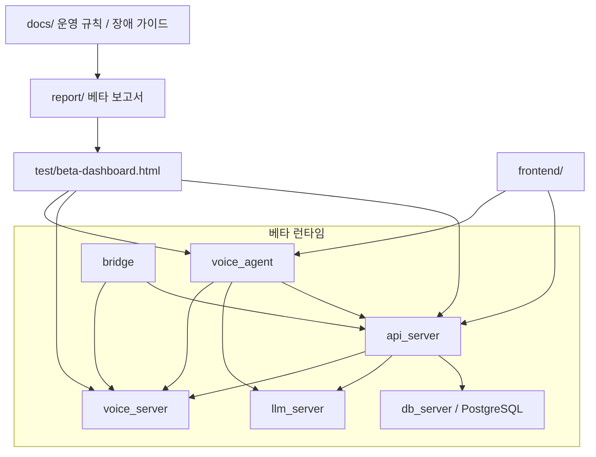
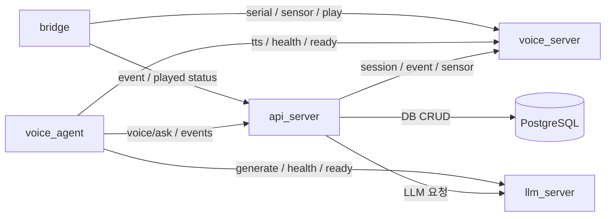
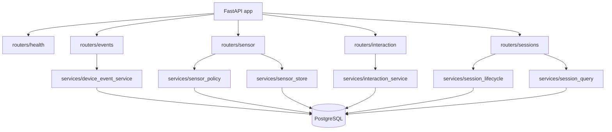
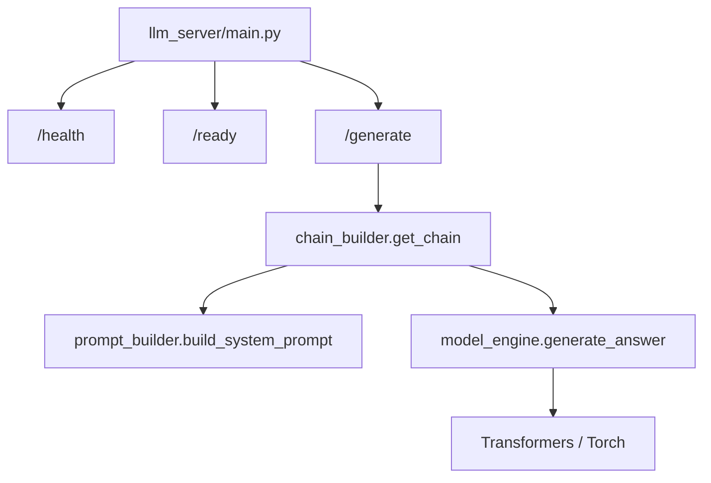
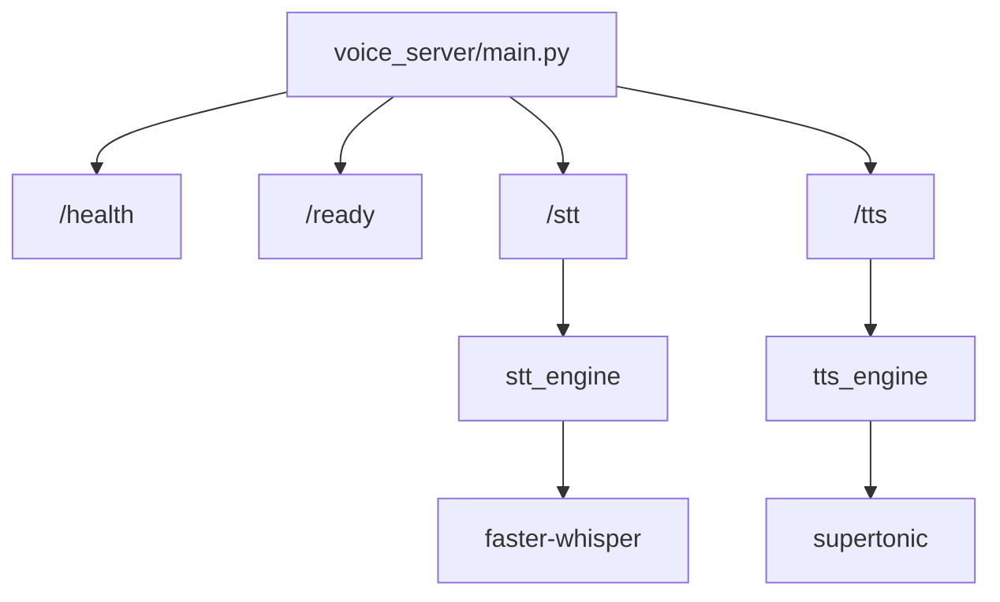
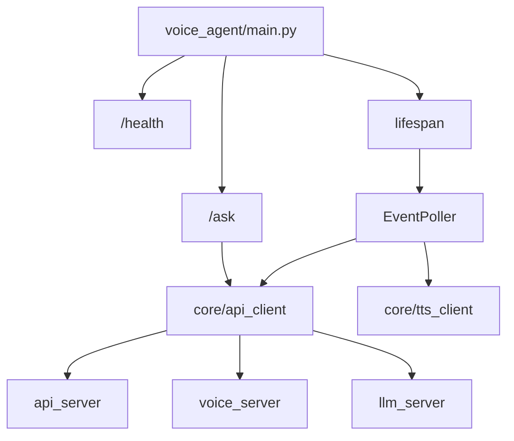
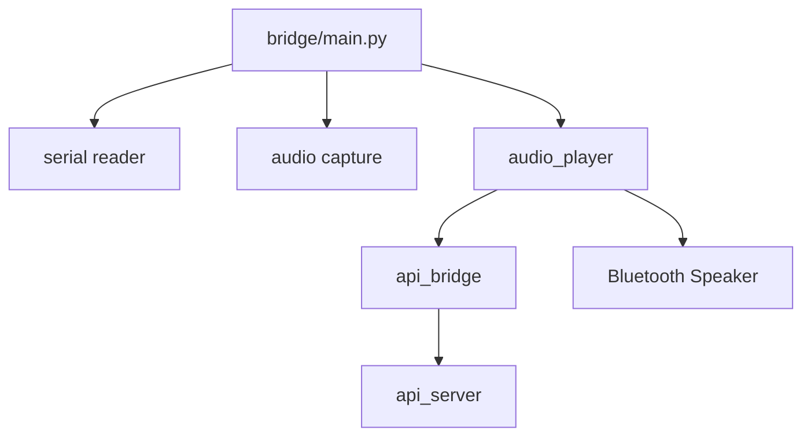
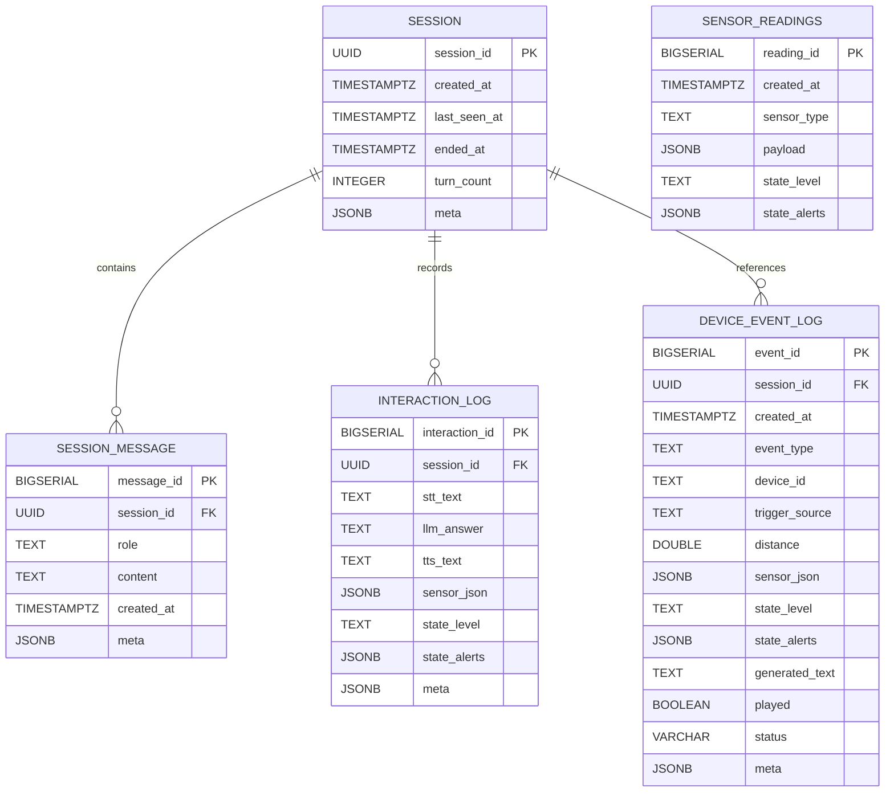
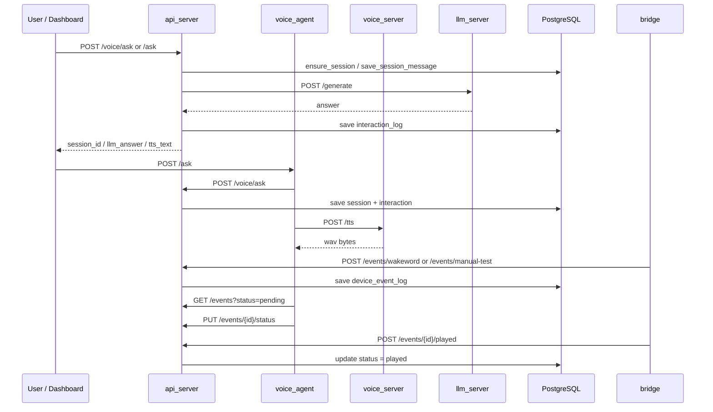
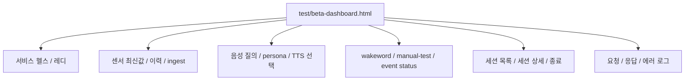

# Super_Marimo 베타 시각 보고서

- 작성 기준: `backend/jiyang` 브랜치의 현재 작업트리
- 대상 범위: 전체 프로젝트, 전체 서버, 각 서버 내부 구조, DB 구조, 이벤트/세션 흐름, 통합 테스트 UI
- 목적: 베타 서비스의 실행 구조와 검증 포인트를 한 문서에서 빠르게 확인하기 위함

## 1. 요약

이번 베타는 `API Server`, `LLM Server`, `Voice Server`, `Voice Agent`, `Bridge`, `DB Server`를 분리된 런타임으로 두고, 실행 모드(`mock / cpu / gpu / dev`)와 health/readiness, 이벤트 상태 전이, 세션 저장, 센서 저장을 서로 일관되게 맞춘 상태를 기준으로 정리했다.

핵심 확인 대상은 다음과 같다.

- 서버 간 연결이 한눈에 보이는가
- 센서 정보가 realtime / hourly 로 분리되어 저장되는가
- 음성 대화가 세션과 메시지, interaction log에 남는가
- 호출어 / 수동 이벤트 / 재생 완료가 상태 전이로 연결되는가
- TTS 음성 선택과 실제 재생이 분리되어 확인되는가
- 종료된 세션이 DB에 남고 `ended_at` 으로 확인되는가

같은 베타 상태를 두 시각에서 확인한다.

- `report/` 문서: 구조와 흐름을 빠르게 검토하는 보고서
- `test/beta-dashboard.html`: 실행 중인 서비스를 직접 두드려 보는 단일 페이지 점검 UI

## 2. 전체 프로젝트 다이어그램

## 3. 전체 서버 다이어그램

## 4. 서버별 다이어그램

### 4.1 API Server

- 역할: 센서 저장, 이벤트 저장, 세션 저장, 음성 질의 저장, 상태 갱신의 단일 진입점
- 주요 엔드포인트:
  - `GET /health`
  - `GET /events`, `PUT /events/{id}/status`, `POST /events/{id}/played`
  - `GET /sensor/latest`, `GET /sensor/history`, `POST /sensor/realtime-ingest`, `POST /sensor/hourly-ingest`
  - `POST /voice/ask`, `POST /ask`
  - `GET /sessions`, `GET /sessions/{session_id}`, `POST /sessions/{session_id}/touch`, `POST /sessions/{session_id}/end`
- 상태 축:
  - `device_event_log.status`
  - `played`
  - `sensor_warning` / `proactive_greeting` 쿨다운

### 4.2 LLM Server

- 역할: 질문과 센서/대화 히스토리를 받아 답변 생성
- 주요 엔드포인트:
  - `GET /health`
  - `GET /ready`
  - `POST /generate`
- readiness 의미:
  - `health`는 프로세스 생존 확인
  - `ready`는 모델 준비와 실행 모드 확인

### 4.3 Voice Server

- 역할: STT / TTS 서비스 제공
- 주요 엔드포인트:
  - `GET /health`
  - `GET /ready`
  - `POST /stt`
  - `POST /tts`
- `ready` 응답에서 확인할 것:
  - `tts_voice_names`
  - `tts_model`
  - `tts_ready`
  - STT 모델 로딩 상태

### 4.4 Voice Agent

- 역할: 음성 질의 파이프라인, 이벤트 폴링, TTS 파일 생성, 세션 유지
- 상태 전이:
  - `pending -> processing -> tts_generated -> playing -> played / failed`
- 확인 포인트:
  - 같은 이벤트를 중복 처리하지 않는가
  - `speak=True`일 때 TTS 파일이 생성되는가
  - `session_id` 가 유지되는가

### 4.5 Bridge

- 역할: 호출어 주변 센서/이벤트 감지, WAV 재생, played 상태 반영
- 확인 포인트:
  - 실제 재생 성공 후에만 `played` 로 마킹되는가
  - 재생 실패 시 `failed` 또는 오류 로그가 남는가
  - bridge와 API 사이의 상태 불일치가 없는가

## 5. DB 다이어그램

### DB에서 확인할 것

- `session` 이 대화 단위의 최상위 단위인지
- `session_message` 가 사용자 / 어시스턴트 메시지를 순서대로 보관하는지
- `interaction_log` 가 LLM / TTS 결과를 하나의 턴으로 남기는지
- `sensor_readings` 가 `realtime` / `hourly` 로 분리되는지
- `device_event_log` 가 `status` 와 `played` 를 함께 보관하는지

## 6. 이벤트 / 세션 흐름

### 이 흐름에서 볼 것

- 세션 생성과 종료가 DB에 남는가
- `voice_agent` 가 `pending` 만 가져오고 다시 중복 처리하지 않는가
- 이벤트가 `processing` 과 `tts_generated` 를 거쳐 재생 완료로 넘어가는가
- 세션 종료 후 `ended_at` 이 채워지는가

## 7. 베타 테스트 UI

### UI에서 확인할 것

- API / LLM / Voice / Agent 헬스 상태가 한 화면에서 보이는가
- realtime / hourly 센서 값을 넣고 최신값과 히스토리를 바로 볼 수 있는가
- `voice/ask` 와 `voice-agent /ask` 를 같은 페이지에서 비교할 수 있는가
- persona memo, system memo, voice_name 이 요청에 반영되는가
- wakeword / manual-test 이벤트가 저장되는가
- 세션을 종료한 뒤 `ended_at` 과 메시지 목록이 유지되는가
- event status 를 직접 바꿔서 `pending / processing / tts_generated / playing / played / failed` 를 점검할 수 있는가

## 8. 검증 상태

- 전체 pytest: `24 passed`
- compose 검증:
  - `docker compose -f docker-compose.yml -f docker-compose.mock.yml config`
  - `docker compose -f docker-compose.yml -f docker-compose.cpu.yml config`
  - `docker compose -f docker-compose.yml -f docker-compose.gpu.yml config`
  - `docker compose -f docker-compose.yml -f docker-compose.dev.yml config`
- 추가 검증:
  - `git diff --check`

## 9. 결론

현재 베타는 단순히 서버가 뜨는 상태가 아니라, 다음을 한 번에 점검할 수 있는 구조로 정리되어 있다.

- 센서 저장
- 이벤트 저장
- 세션 저장
- 음성 질의
- TTS 선택
- 호출어 감지
- 재생 상태 반영
- 종료 세션 확인

즉, `report/` 문서는 구조와 흐름의 지도이고, `test/beta-dashboard.html` 은 그 지도를 실제로 눌러 보는 현장 검증 도구다.
