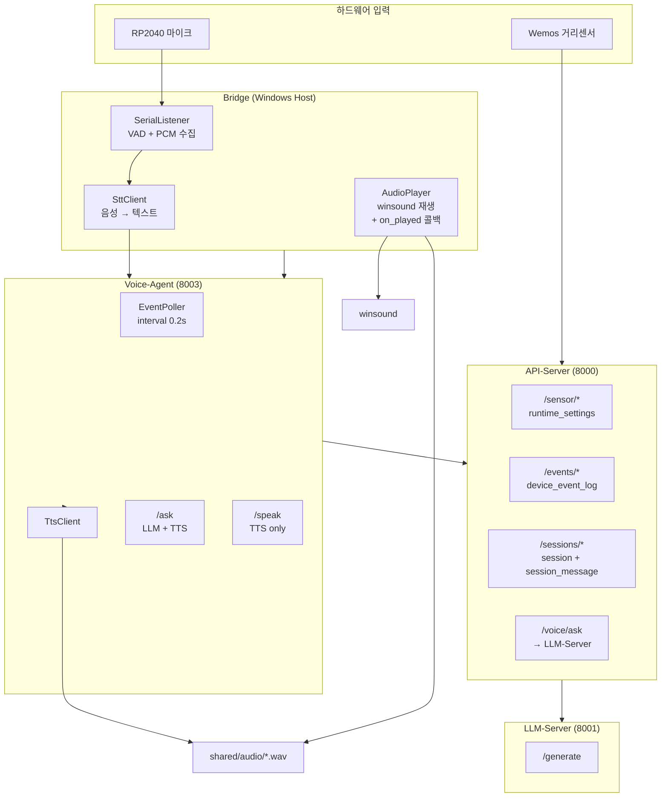
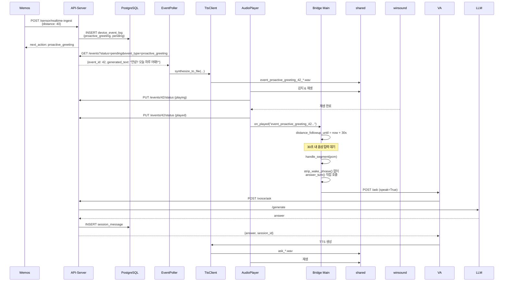
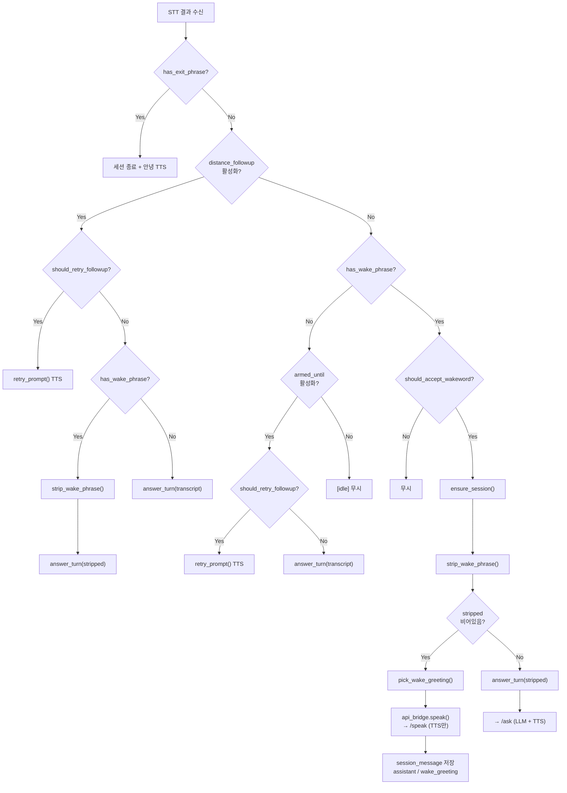
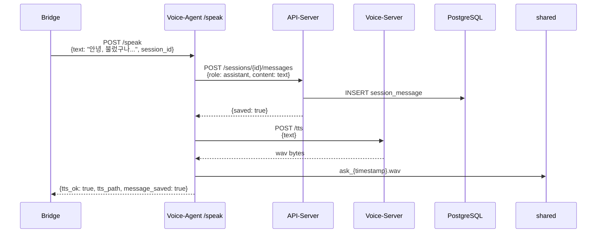
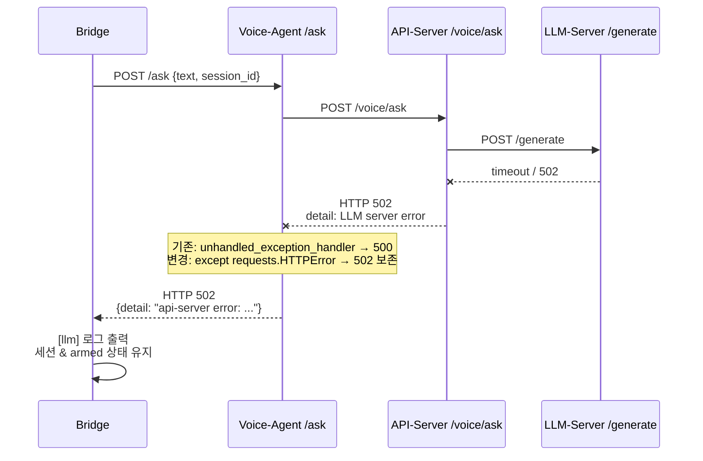
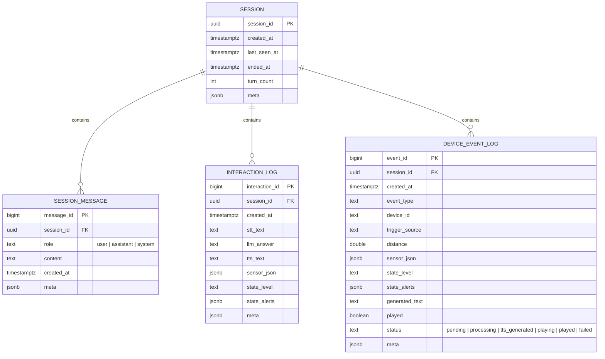

# 음성 모드 안정화 + 조도 Raw 수집 계획 보고서

## 다이어그램

### 1. 전체 아키텍처 (변경 후)



---

### 2. 거리 감지 → 인사 → 후속 대화 흐름



---

### 3. 호출어 감지 분기 흐름 (Wake → TTS만 / 질문 → LLM)



---

### 4. Voice-Agent `/speak` 내부 흐름



---

### 5. API-Server 502 오류 전파 개선 흐름



---

### 6. 세션 저장 구조 (음성/챗 통합)



---

## 요약

이번 작업은 **음성 모드 안정화**를 위한 4가지 핵심 개선과 **조도 Raw 수집** 계획을 정리한 것이다.

| 영역 | 변경 전 | 변경 후 |
|------|---------|---------|
| 거리 인사 후 대화 | 인사만 하고 끝 | 인사 재생 완료 후 30초 자동 대화창 열림 |
| 호출어 처리 | 무조건 `/ask` → LLM 호출 | 호출어만 → TTS 인사만, 질문 있으면 → LLM |
| Voice-Agent | `/ask`만 존재 | `/speak` 추가 (TTS만, session_message 저장) |
| 오류 전파 | api-server 502 → voice-agent 500 뭉개짐 | 502 그대로 보존, bridge에서 `[llm]` 로그 분리 |
| AudioPlayer | 재생 완료 후 status만 갱신 | `on_played` 콜백으로 bridge에 이벤트 전달 |

---

## 변경 파일 목록

| 파일 | 변경 내용 |
|------|-----------|
| `voice_agent/main.py` | `/speak` 엔드포인트 추가, `/ask` try/except로 502 보존, `SpeakPayload`/`SpeakResponse` 모델 추가 |
| `voice_agent/core/api_client.py` | `save_session_message()` 메서드 추가 |
| `api_server/routers/sessions.py` | `POST /sessions/{id}/messages`, `GET /sessions/{id}/messages` 엔드포인트 추가 |
| `bridge/core/audio_player.py` | `on_played` 콜백 파라미터 추가, proactive_greeting 재생 완료 시 콜백 호출 |
| `bridge/core/api_bridge.py` | `speak()` 메서드 추가 (voice-agent `/speak` 호출) |
| `bridge/main.py` | `_on_audio_played`, `_handle_distance_followup`, `_handle_wake` 추가, distance followup timeout 지원 |
| `bridge/config.py` | `--distance-followup-timeout-sec` 인자 추가 (기본 30초) |

---

## 검증 결과

```bash
$ python -m pytest api_server/tests voice_agent/tests -q
....................
==============================
20 passed, 4 warnings in 0.52s
```

- 기존 api-server 테스트 13개, voice-agent 테스트 7개 전부 통과
- bridge 테스트 중 2개는 `.pytest-tmp` Windows 권한 문제로 실패했으나, 이는 코드 오류가 아닌 환경 문제

---

## 변경 완료 (2026-05-20)

### 조도 Raw 수집 구현 완료
- `api_server/extensions/db.py`: `light_raw_samples` 테이블 추가 (`sample_id`, `created_at`, `raw_value`)
- `api_server/services/sensor_store.py`: `save_light_raw_sample()`에 10분 rate-limit 구현
  - `SELECT MAX(created_at)`으로 마지막 저장 시간 확인
  - `LIGHT_RAW_SAMPLE_INTERVAL_SECONDS` (기본 600초) 이내 중복 호출 시 스킵
  - 스킵 시 `{saved: False, skipped: True, cooldown_remaining_sec: N}` 반환
- `api_server/routers/sensor.py`: `/sensor/realtime-ingest`와 `/sensor/hourly-ingest` 모두에서 `save_light_raw_sample()` 호출
- `api_server/config.py`: `LIGHT_RAW_SAMPLE_INTERVAL_SECONDS` 환경변수 추가

## 남은 이슈

1. **EVENT_POLLER_INTERVAL 기본값**: 현재 `voice_agent/main.py`의 기본값은 여전히 `1.0`이다. CPU 모드에서 `0.2`로 낮추려면 `.env.cpu`에서 `EVENT_POLLER_INTERVAL=0.2`를 명시해야 한다.
2. **Bridge 통합 테스트**: 실제 COM 포트와 마이크가 없는 환경에서는 `bridge/main.py`의 거리 감지 후 followup 흐름을 실제 하드웨어로 검증해야 한다.
3. **wake 인사 중복 저장**: `/speak`가 항상 `session_message`에 저장하므로, 동일 세션에서 여러 번 wake를 호출하면 인사 문장이 여러 번 쌓인다. 이는 의도된 동작이지만, 나중에 중복 제거가 필요할 수 있다.

---

## 다음 단계

1. `docker-compose.cpu.yml`에 `EVENT_POLLER_INTERVAL=0.2` 환경변수 추가
2. `api_server/extensions/db.py`에 `light_raw_samples` 테이블 추가
3. `api_server/services/sensor_store.py`에 10분 rate-limit `save_light_raw_sample` 구현
4. `api_server/routers/sensor.py`에 `GET /sensor/light-raw-samples` 추가
5. 실제 하드웨어 연결 후 다음 시나리오 검증:
   - 50cm 이내 진입 → 인사 TTS → 바로 "오늘 날씨 어때?" → 호출어 없이 답변
   - "안녕 마리모" → 인사 TTS만 → 다음 발화 "오늘 날씨 어때?" → LLM 답변
   - "안녕 마리모 오늘 날씨 어때?" → 호출어 제거 후 바로 LLM 답변
