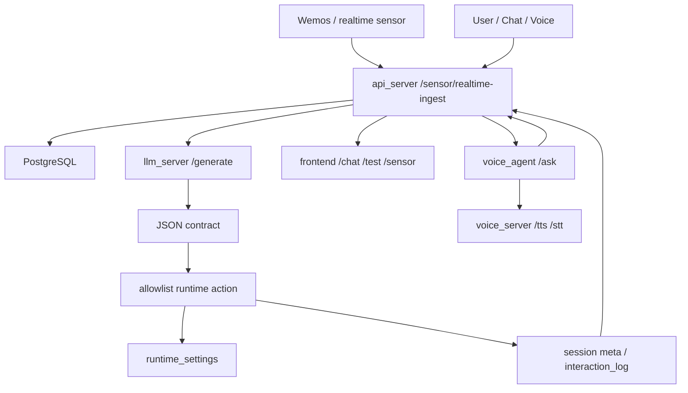
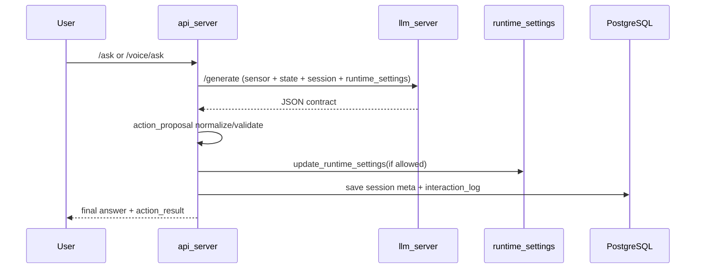
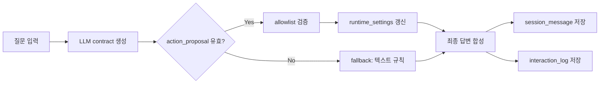
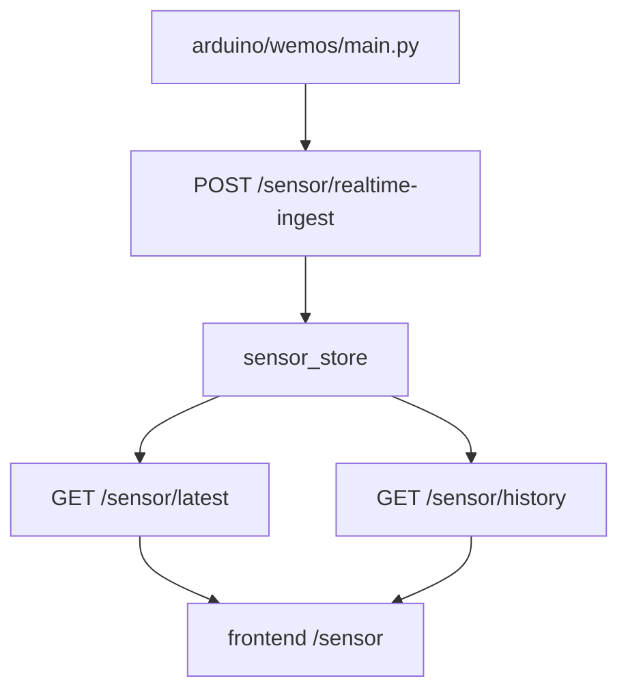
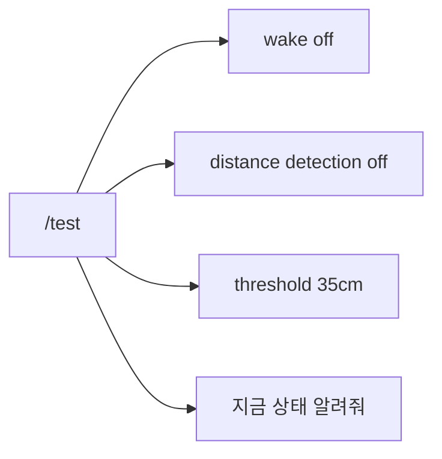
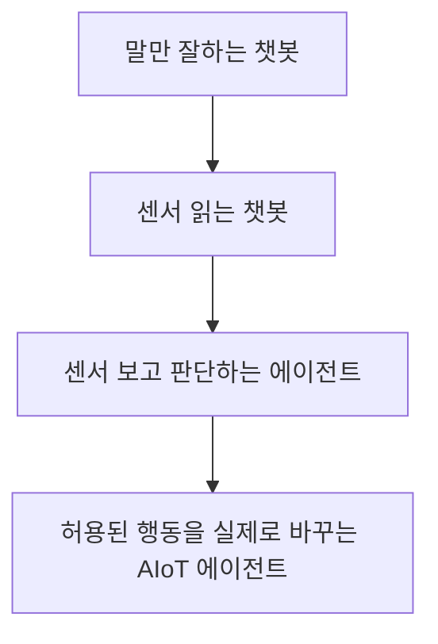

# Super_Marimo 센서-LLM 에이전트화 보고서
- 작업 기준: `C:\Projects\_active\Super_Marimo`
- 대상 범위: `llm_server`, `api_server`, `frontend`, `voice_agent`, `arduino/wemos`
- 목적: 센서 입력을 LLM 응답과 연결해, 단순 답변기가 아니라 **센서 기반 판단 + 안전한 행동 제안 + 서버 실행 + 결과 기록**이 이어지는 AIoT 에이전트 구조로 전환하기

## 1. 한눈에 보기

이번 작업은 프로젝트를 크게 세 단계로 바꿨다.

1. 센서 데이터는 realtime 중심으로 정리한다.
2. LLM은 자유문장 대신 JSON 계약으로 답한다.
3. 서버는 JSON 안의 안전한 액션만 실행하고, 그 결과를 세션과 interaction log에 남긴다.

즉, 아래처럼 바뀌었다.

```text
Before
센서 → API 저장 → LLM 문자열 답변 → 세션 저장

After
센서 → API 저장 → LLM JSON 계약(answer + action_proposal) → allowlist 검증 → runtime action 실행 → 최종 답변 저장
```

### 핵심 변화 표

| 구분 | 이전 | 이후 |
|---|---|---|
| LLM 출력 | 일반 문자열 | JSON 계약 |
| 행동 처리 | 텍스트 규칙 기반만 사용 | LLM 제안 + 서버 검증 + fallback 텍스트 규칙 |
| 세션 기록 | 답변 위주 | 답변 + action_result + llm contract |
| 안전성 | 모델 출력에 의존 | allowlist 기반 실행 |
| 에이전트성 | 센서가 있어도 답변기 수준 | 센서 보고, 행동 제안하고, 실제 설정을 바꾸는 루프 |

## 2. 전체 구조



이 구조의 핵심은 LLM이 직접 시스템을 건드리지 않는다는 점이다.

- LLM은 제안만 한다.
- API 서버가 허용된 항목만 걸러 실행한다.
- 실행 결과는 다시 세션과 로그로 남긴다.

## 3. LLM JSON 계약

### 3.1 계약 모양

`llm_server`는 이제 아래 형태를 반환한다.

```json
{
  "answer": "짧고 자연스러운 한국어 답변",
  "action_proposal": {
    "action_type": "update_runtime_settings",
    "patch": {
      "wake_enabled": false
    },
    "summary": "깨우기 기능을 껐어요."
  },
  "confidence": 0.91,
  "reason": "질문의 의도가 설정 변경이기 때문입니다."
}
```

### 3.2 허용된 액션

서버가 받는 액션은 아주 좁게 묶었다.

| 허용 키 | 의미 |
|---|---|
| `wake_enabled` | 깨우기 기능 on/off |
| `distance_detection_enabled` | 거리 감지 on/off |
| `distance_threshold_cm` | 거리 기준값 변경 |

### 3.3 계약 흐름 다이어그램



### 3.4 왜 JSON이 필요한가

기존에는 LLM이 그냥 답변만 했기 때문에, 센서가 있어도 “말만 잘하는 모델”에 가까웠다.

JSON 계약으로 바꾸면:

- 답변과 행동 제안을 분리할 수 있다.
- 안전한 행동만 서버가 실행할 수 있다.
- 실패 시 fallback 답변으로 돌아갈 수 있다.
- 나중에 UI에서 `confidence`, `reason`, `action_result`를 따로 보여줄 수 있다.

## 4. 런타임 액션 실행 루프



### 실제 동작 규칙

- 질문이 제어 의도면
  - LLM이 행동을 제안한다.
  - 서버가 실행한다.
  - 최종 답변에는 바뀐 설정을 붙인다.

- 질문이 정보 요청이면
  - LLM이 행동 없이 설명만 낸다.
  - 서버는 액션을 실행하지 않는다.

- JSON이 깨지면
  - 안전한 문자열 답변으로 fallback 한다.

## 5. 센서 경로 정리

이전에는 realtime / hourly / raw가 섞여 있어서 화면과 데이터 흐름이 복잡했다.

현재 방향은 realtime 기준으로 단순화하는 것이다.



### 현재 센서 화면의 원칙

- 온도
- 습도
- 조도
- 수위 raw
- 거리

이 다섯 개만 핵심으로 본다.

반대로 아래는 live 화면에서 제거하거나 더 이상 핵심 경로로 쓰지 않는다.

- `hourly`
- 조도 raw 평균 요약 카드
- 수위 raw 평균 요약 카드
- 거리감지 / 깨우기 / 웹 음성 토글을 센서 페이지에 같이 두는 방식

## 6. frontend에서 보이는 변화

### 6.1 페이지 구성

`frontend`는 지금 다음 5개만 남겼다.

- Dashboard
- Events
- 놀이방
- Sensor
- Chat

### 6.2 테스트 화면

`/test`는 큰 버튼으로 빠르게 실험하는 용도다.



### 6.3 Chat 화면

`/chat`은 LLM 계약과 액션 결과를 바로 확인하기 쉽다.

- 질문 입력
- 응답 확인
- `last action` 표시
- 세션 저장 결과 확인

즉, 브라우저만으로도 LLM 테스트가 가능하다.

## 7. 변경 파일 목록

### LLM 계층

- `llm_server/prompt_builder.py`
- `llm_server/contracts.py`
- `llm_server/model_engine.py`
- `llm_server/chain_builder.py`
- `llm_server/main.py`
- `llm_server/tests/test_main.py`

### API 계층

- `api_server/services/llm_action_contract.py`
- `api_server/services/interaction_service.py`
- `api_server/tests/test_interaction_service.py`
- `api_server/tests/test_interaction_persona.py`

### 기존 센서 / 디바이스 / UI 계층

이번 작업과 맞물려 이미 바뀐 관련 파일들:

- `api_server/services/runtime_action_service.py`
- `api_server/services/runtime_settings.py`
- `api_server/services/sensor_policy.py`
- `api_server/services/sensor_store.py`
- `api_server/services/sensor_judge.py`
- `api_server/services/sensor_utils.py`
- `arduino/wemos/main.py`
- `arduino/wemos/settings.py`
- `arduino/wemos/deploy.py`
- `frontend/src/App.tsx`
- `frontend/src/components/Layout.tsx`
- `frontend/src/pages/ChatPage.tsx`
- `frontend/src/pages/DashboardPage.tsx`
- `frontend/src/pages/SensorPage.tsx`
- `frontend/src/pages/TestPage.tsx`
- `frontend/src/api.ts`
- `voice_agent/main.py`
- `voice_agent/core/api_client.py`

## 8. 검증 결과

이번 변경은 코드만 바꾼 것이 아니라 테스트로 확인했다.

```text
python -m pytest llm_server/tests/test_main.py api_server/tests/test_interaction_service.py api_server/tests/test_interaction_persona.py -q
7 passed
```

추가로 문법 검증도 통과했다.

```text
python -m py_compile
```

### 테스트가 의미하는 것

- LLM이 JSON 계약을 반환하는지 확인
- action proposal이 allowlist로 정리되는지 확인
- fallback 텍스트 경로가 남아 있는지 확인
- `/ask` 경로가 session / interaction log 저장까지 이어지는지 확인
- persona/system memo 전달이 유지되는지 확인

## 9. 구조적 의미

이번 변경은 단순 기능 추가가 아니다.

프로젝트의 역할이 이렇게 바뀌었다.



즉, 다음 3개가 동시에 성립해야 AIoT 에이전트라고 부를 수 있다.

1. 센서를 읽는다.
2. 답변과 함께 행동을 제안한다.
3. 제안된 안전한 행동이 실제 runtime_settings로 반영된다.

## 10. 남은 과제

이번 단계에서 끝내지 않은 것들도 있다.

- 더 풍부한 액션 allowlist
- action_result를 UI에서 더 예쁘게 시각화
- LLM이 action proposal을 더 안정적으로 내도록 프롬프트 튜닝
- 필요 시 `/chat`과 `/test`에 action confidence 시각화 추가
- 센서 데이터의 상태 해석 규칙을 더 정교하게 분리

## 11. 결론

이번 작업의 핵심은 “답변”과 “행동”을 분리한 것이다.

이전에는:

- 센서가 있어도 LLM은 그냥 답만 했다.

지금은:

- 센서를 보고
- JSON으로 행동을 제안하고
- 서버가 안전한 것만 실행하고
- 결과를 세션과 로그에 남기고
- 최종 답변에 실행 결과를 반영한다

그래서 `Super_Marimo`는 이제 단순 음성/센서 통합 앱이 아니라, **센서-LLM-행동 루프가 닫히는 AIoT 에이전트**로 한 단계 올라갔다.
