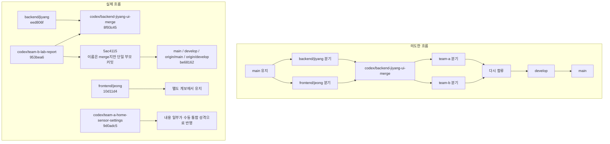

# 브랜치 히스토리 설명

## 1. 목적
이 문서는 현재 저장소의 Git 히스토리를 기준으로 브랜치 흐름을 설명한다.

목적은 히스토리를 다시 쓰는 것이 아니라, 팀원과 리뷰어가 실제 통합 과정을 오해 없이 이해하도록 돕는 것이다.

## 2. 다이어그램

## 3. 현재 브랜치 역할 요약
- `main`: 최종 결과물을 가리키는 대표 브랜치다.
- `develop`: 현재는 `main`과 같은 커밋을 가리키는 통합 브랜치다.
- `backend/jiyang`: 실제 메인 계보에 연결된 핵심 작업 줄기다.
- `frontend/jeong`: 프론트 작업이 누적된 별도 계보다.
- `codex/backend-jiyang-ui-merge`: 이름과 달리 `frontend/jeong` 전체를 합친 브랜치가 아니라, `team-b` 계열 병합 흔적에 가깝다.
- `codex/team-a-home-sensor-settings`: Team A 화면 작업 브랜치다.
- `codex/team-b-lab-report`: Team B 작업이 반영된 브랜치다.

## 4. 의도한 운영 방식
원래 의도한 흐름은 아래와 같았다.

1. `main`을 기준으로 `backend/jiyang`과 `frontend/jeong`을 분리한다.
2. 두 브랜치를 `codex/backend-jiyang-ui-merge`에서 합친다.
3. 여기서 다시 `team-a`, `team-b`로 나눠 병렬 작업을 진행한다.
4. 두 작업을 다시 합친 뒤 `develop`을 거쳐 `main`으로 정리한다.

이 방식은 `docs/04_브랜치_운영_원칙.md`에 있는 이상적인 운영 기준과도 방향이 맞다.

## 5. 실제 Git 히스토리
현재 원격 브랜치와 커밋 그래프를 기준으로 보면 실제 히스토리는 조금 다르게 남아 있다.

### 5-1. 최종 포인터 상태
- `main`, `develop`, `origin/main`, `origin/develop`은 현재 모두 `be68162`를 가리킨다.
- 따라서 마지막 상태는 `develop`과 `main`이 분리되어 흘렀다기보다, 같은 최종 결과물에 맞춰진 상태로 보는 편이 정확하다.

### 5-2. `frontend/jeong`의 위치
- `frontend/jeong`은 `10d11d4`를 가리키고 있다.
- 이 브랜치는 현재 메인 계보와 직접 연결된 merge 이력이 없다.
- 즉 `backend/jiyang`과 같은 줄기에서 갈라져 다시 공식 merge된 형제 브랜치라기보다, 별도 계보에 남아 있는 프론트 작업 줄기로 해석하는 것이 맞다.

### 5-3. `codex/backend-jiyang-ui-merge`의 의미
- `codex/backend-jiyang-ui-merge`의 팁은 `8f93c45`다.
- 이 커밋은 실제로는 두 부모를 가진 merge commit이다.
- 다만 merge 대상은 `frontend/jeong` 전체가 아니라 `codex/team-b-lab-report` 계열이다.
- 따라서 이름만 보면 backend와 frontend 전체를 합친 것처럼 보이지만, Git 기록상으로는 `team-b` 쪽 변경을 받은 중간 병합 브랜치에 가깝다.

### 5-4. `team-a`와 `team-b`의 합류 방식
- `codex/team-b-lab-report`의 팁은 `953bea6`이며, 이 줄기는 최종 메인 계보에 연결되어 있다.
- `codex/team-a-home-sensor-settings`의 팁은 `9d0adc5`이며, 이 브랜치 자체는 최종 메인 계보에 직접 merge된 형태로 남아 있지 않다.
- `5ac4115`는 커밋 메시지상 `Merge team-a and team-b frontend features`지만, Git 기준으로는 부모가 하나뿐인 일반 커밋이다.
- 따라서 실제 그래프에서는 `team-a` 브랜치가 true merge로 연결된 것이 아니라, 일부 내용이 수동 통합 또는 squash 성격으로 흡수된 것으로 보는 편이 정확하다.

## 6. 차이가 발생한 이유
이번 히스토리 차이는 작업 자체가 틀렸다는 뜻은 아니다.

다만 아래 같은 사유로 Git 그래프와 작업 의도가 완전히 일치하지 않게 남았다.

- 브랜치 이름과 실제 merge 대상이 완전히 일치하지 않은 구간이 있었다.
- 일부 통합은 PR merge 대신 수동 반영 또는 단일 커밋 정리 방식으로 처리되었다.
- `frontend/jeong` 작업은 결과 일부가 참고 또는 반영되었더라도, 브랜치 자체는 메인 계보에 공식 merge된 형태로 남지 않았다.
- 마지막에는 `develop`과 `main`이 같은 결과물을 가리키도록 정리되면서, 단계별 승격 기록이 단순해졌다.

## 7. 발표/공유 시 설명 기준
발표나 문서에서는 아래처럼 설명하는 것이 가장 안전하다.

1. `main`은 최종 통합 결과물 브랜치라고 설명한다.
2. `backend/jiyang`은 실제 메인 계보에 연결된 핵심 작업 줄기라고 설명한다.
3. `frontend/jeong`은 별도 프론트 작업 계보로 남아 있으며, 결과 일부는 최종 통합 과정에서 반영되었다고 설명한다.
4. `codex/backend-jiyang-ui-merge`는 backend와 frontend 전체를 완전 병합한 브랜치라기보다, 중간 통합 시도 브랜치라고 설명한다.
5. `team-a`와 `team-b`는 병렬 작업 후 일부가 true merge, 일부가 수동 통합 성격으로 최종 줄기에 흡수되었다고 설명한다.
6. 따라서 실제 제출 기준은 "브랜치 그래프의 모양"보다 "최종 결과물과 통합 내용"에 있다고 정리한다.

## 8. 결론
현재 저장소는 브랜치 전략의 의도와 실제 Git 그래프가 완전히 일치하지는 않는다.

하지만 최종 결과물 기준으로는 `main`과 `develop`이 같은 커밋을 가리키고 있고, 핵심 기능 통합도 이미 반영되어 있다.

따라서 이 저장소는 Git 히스토리를 다시 쓰기보다, 실제 흐름을 정확히 설명하는 문서를 함께 두는 방식으로 관리하는 것이 적절하다.
