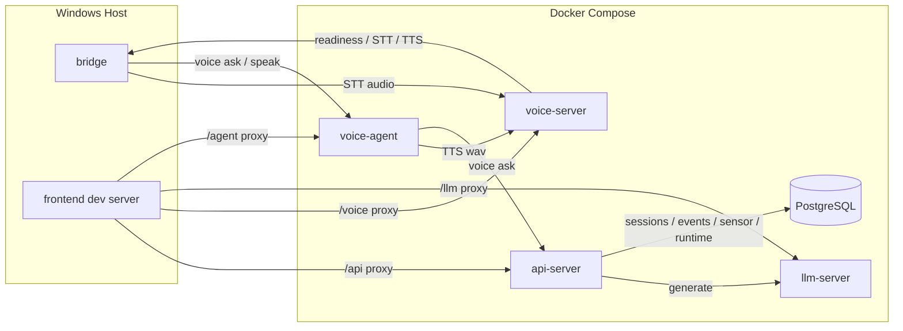
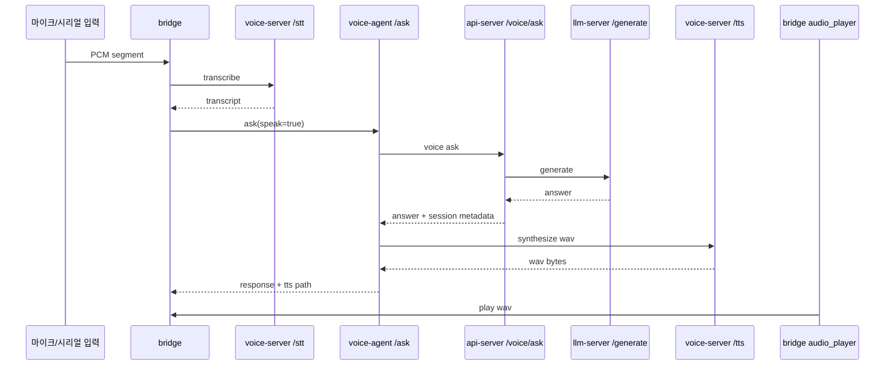
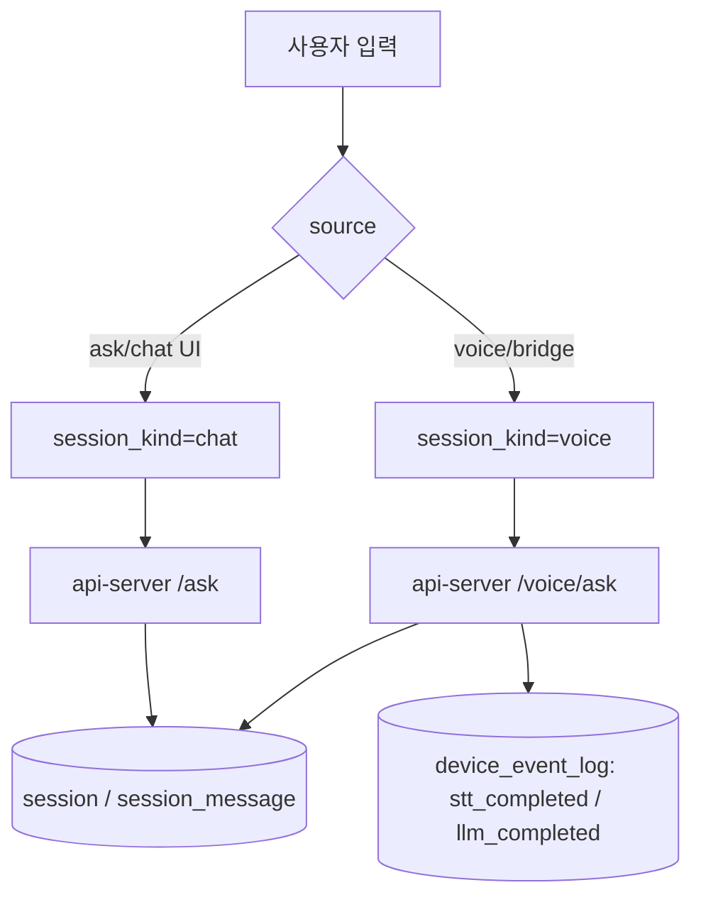
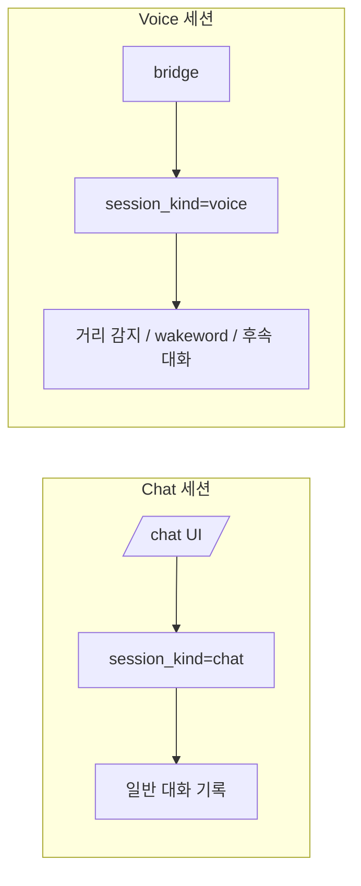
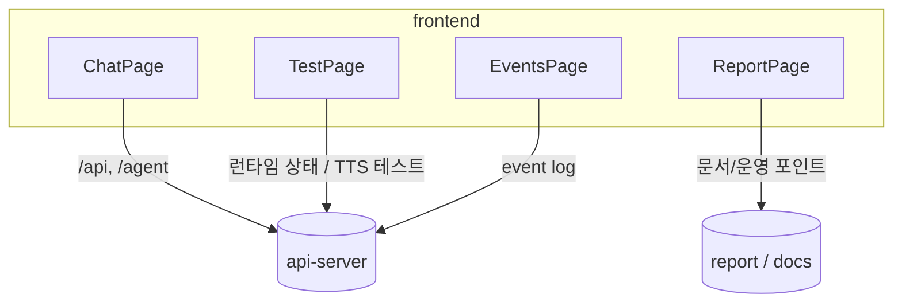
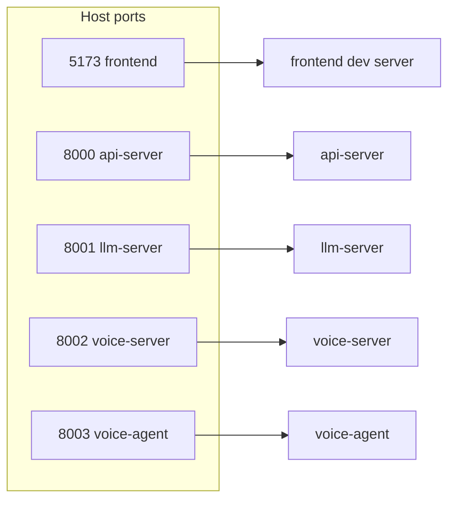
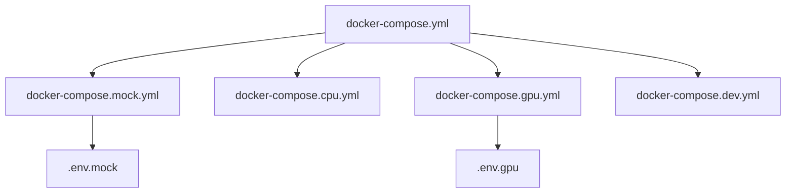

# 음성 루프와 프론트/백엔드 연결 상태 보고서

## 요약
이번 작업은 `lab/test`에서 보이던 환경 대화 모드를 실제 음성 제품 흐름으로 연결하는 데 집중했다.  
핵심은 `거리 감지 -> wakeword -> STT -> LLM -> TTS` 루프를 안정화하고, `chat` 세션과 `voice` 세션을 분리하며, 프론트 `lab/test`가 현재 백엔드 상태를 정확히 반영하도록 맞춘 것이다.

이번 보고서는 최근 개선 범위만 다룬다.

## 전체 구조

## 음성 루프

## 세션 분기

## 프론트 연결

프론트에서 실제로 중요한 점은 `lab/test`가 단순 버튼 모음이 아니라, 현재 런타임 상태를 확인하는 진단면이라는 점이다.  
즉, `web_voice_enabled`, `wake_enabled`, `distance_detection_enabled`, `distance_threshold_cm` 같은 상태를 백엔드와 같은 기준으로 보여줘야 혼동이 없다.

## Docker / 포트 매핑

## 변경 내용

- `bridge`
  - TTS 재생과 STT 감지를 분리해서, 자기 목소리가 다시 STT로 먹히는 상황을 줄였다.
  - `reply window`와 `tts mute`를 분리해 후속 발화는 빨리 받되, 재생 꼬리는 차단했다.
  - wakeword는 거리 임계치와 현재 런타임 상태를 함께 보고 허용하도록 맞췄다.

- `voice_agent`
  - `/ask`와 `/speak` 경로가 `api-server -> llm-server -> voice-server`를 거쳐 TTS wav를 만들고, 브리지의 음성 재생으로 이어진다.
  - `session_kind=voice`를 유지해 음성 세션과 채팅 세션이 섞이지 않게 했다.
  - TTS 합성을 요청 경로와 분리해 응답 지연을 낮추는 방향으로 정리했다.

- `api_server`
  - `/ask`, `/voice/ask`, `session`, `session_message`, `device_event_log`를 같은 맥락에서 관리한다.
  - 음성 경로는 `stt_completed`, `llm_completed` 이벤트로 추적된다.
  - 세션은 `chat`과 `voice`로 나뉘어 기록된다.

- `voice_server` / `llm_server`
  - `voice-server`는 STT/TTS 전용이며, `llm-server`는 로컬 LLM 생성만 맡는다.
  - GPU 모드에서는 `.env.gpu`와 `docker-compose.gpu.yml` 조합이 필요하다.

## 검증

- 브리지 음성 루프 테스트
  - `bridge/tests/test_exit_flow.py`
  - `bridge/tests/test_vad_profile.py`
  - `bridge/tests/test_wakeword_gate.py`
  - `bridge/tests/test_audio_player.py`

- 백엔드 세션/이벤트 테스트
  - `api_server/tests/test_interaction_service.py`
  - `api_server/tests/test_sensor_policy.py`
  - `api_server/tests/test_sessions_end.py`

- voice-agent 테스트
  - `voice_agent/tests/test_voice_agent_persona.py`
  - `voice_agent/tests/test_event_poller.py`

## 운영 포인트

- GPU 모드로 올릴 때는 반드시 `docker compose -f docker-compose.yml -f docker-compose.gpu.yml --env-file .env.gpu up -d --build` 조합을 사용해야 한다.
- `voice-server`가 mock으로 뜨면 브리지에서 STT가 `"모의 STT 결과입니다."`로 들어오므로, `RUN_MODE`와 `mock_mode`를 먼저 확인해야 한다.
- 프론트 `lab/test`는 강제 실행 버튼이 아니라 현재 런타임 상태와 음성 모드 진단을 보는 화면으로 쓰는 것이 맞다.
- `voice-agent`가 죽으면 프론트의 `/agent` 프록시가 `Bad Gateway`를 낸다. `voice-agent` health와 컨테이너 상태를 먼저 본다.

## 다음 확인 포인트

1. `voice-server /ready`에서 `mock_mode=false` 확인
2. `voice-agent /health`에서 세션과 이벤트 폴러 상태 확인
3. `frontend lab/test`에서 현재 런타임 상태와 voice mode 표시 확인
4. `bridge` 로그에서 `reply window`, `tts mute`, `wakeword` 순서 확인

