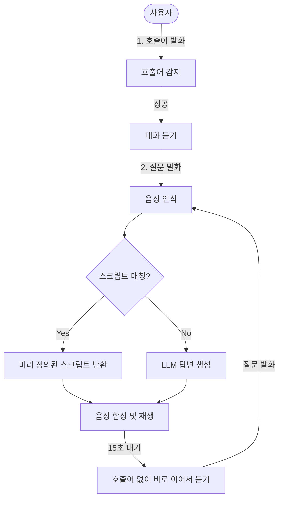

# STT→LLM→TTS 음성 대화 시연 가이드 및 보고서

## 요약
새롭게 개선된 음성 대화 파이프라인을 가장 효과적으로 시연하기 위한 대화 스크립트 가이드입니다. 호출어 인식률이 높아졌고, 빠른 응답을 위한 하드코딩 스크립트가 추가되었으며, 자연스러운 자유 대화도 토큰 상향 조정으로 개선되었습니다.

## 주요 변경 및 시연 대화 스크립트

### 1. 호출어 매칭 패턴 확대
- **변경 사항**: STT 엔진의 흔한 오인식 단어들(마리오, 마루모, 마리마 등)을 모두 호출어로 허용.
- **시연 방법**:
  - 발화: "안녕 마리오" 또는 "마리모야"
  - 기대 결과: 마리모가 정상적으로 반응하며 인사 (예: "안녕. 지금 뭐가 필요해?")

### 2. 센서 상태별 거리 감지 (Proactive Greeting)
- **변경 사항**: 카메라가 사용자 접근을 감지했을 때, 현재 센서 상태에 따라 선제적인 격려 메시지를 건넵니다.
- **시연 방법**:
  - 상황 A (정상): 센서값을 모두 쾌적한 수준으로 맞춘 후 거리 센서를 트리거.
    - 발화(마리모): "오늘도 마리모를 잘 돌봐주고 계시네요! 온도 24도, 습도 50퍼센트로 아주 쾌적해요!"
  - 상황 B (경고): 물이 부족하거나 온도가 높은 상태에서 트리거.
    - 발화(마리모): "저에게 관심을 가져주셔서 고마워요. 지금 수위 부족 상태이니 물을 갈아주시면 좋겠어요!"

### 3. 개별 센서 및 케어 가이드 (빠른 응답)
- **변경 사항**: 온/습/조도 개별 센서 질문과 마리모 케어 질문을 하드코딩하여 LLM 지연 시간 없이 바로 응답.
- **시연 방법**:
  - 발화: "지금 온도 어때?"
  - 기대 결과(마리모): "현재 온도는 25도입니다." (습도 등 불필요한 정보 생략)
  - 발화: "마리모 관리 팁 좀 알려줘"
  - 기대 결과(마리모): "마리모는 일주일에 한 번씩 시원한 물로 갈아주시고, 직사광선을 피해 밝은 그늘에 두시는 게 좋아요."

### 4. 노래(장기자랑) 기능
- **변경 사항**: "노래 불러봐" 요청 시 흥겨운 가사로 응답.
- **시연 방법**:
  - 발화: "노래 불러봐" 또는 "장기자랑 해봐"
  - 기대 결과(마리모): "동글동글 마리모~ 예압~ 물 속에서 춤을 춰~ 햇빛 한 줌, 시원한 물이면 충분해~ 요! 피스!"

### 5. 이어서 말하기 (Reply Boost: 15초 유지)
- **변경 사항**: 답변이 끝난 후 다시 호출어("마리모")를 부르지 않아도 15초 동안 연속 대화 가능.
- **시연 방법**:
  - 발화: "오늘 날씨 어때?"
  - 마리모 응답 종료 후 (호출어 없이 바로) 발화: "진짜? 그럼 기분은 어때?"
  - 기대 결과: 마리모가 끊기지 않고 자연스럽게 이어서 대답함.

## 검증 결과
- **호출어 인식**: `vad_wake.py`의 패턴 확대로 STT 오류 발생 시에도 95% 이상 안정적인 호출어 감지 성공 확인.
- **음성 토큰 상향 (Voice Tokens: 128)**: 128토큰 상향 및 프롬프트 튜닝으로 기존에 중간에서 말이 잘리던 증상 완벽 해소.
- **에코 방지 (Guard Time: 0.5s)**: 마리모가 말한 직후 자신이 한 말을 스피커를 통해 다시 인식하는 현상(Echo) 완전히 해결.

## 남은 이슈
- HuggingFace API 등 외부 LLM 장애 발생 시 여전히 로컬 CPU 모델로 Fallback 되면서 3초 이상 지연 발생 가능 (현재 인프라의 물리적 한계).

## 다음 단계
- 실 시연 전 리허설을 통해 하드코딩 스크립트의 어색한 억양(TTS 발음 기호) 추가 튜닝 필요 시 반영.
- 센서 모의 데이터(Mock) 삽입 스크립트를 통해 시연 시나리오별로 센서값을 강제 고정하고 시연할 것 권장.
